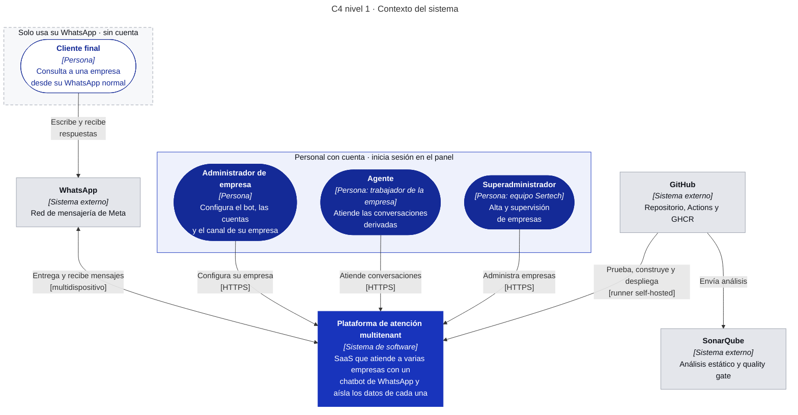

# C4 · Nivel 1 — Diagrama de contexto

Muestra la plataforma como una sola caja, las personas que se relacionan con ella y los sistemas externos con los que se comunica. El **cliente final no ingresa a la plataforma**: escribe desde su WhatsApp normal. Solo el personal de cada empresa y el equipo de Sertech inician sesión en el panel ([ADR-0004](../../adr/0004-cliente-final-solo-whatsapp.md)).

**Leyenda:** azul oscuro = personal con cuenta · contorno azul = cliente final, sin cuenta · azul = sistema que construimos · gris = sistema externo.
