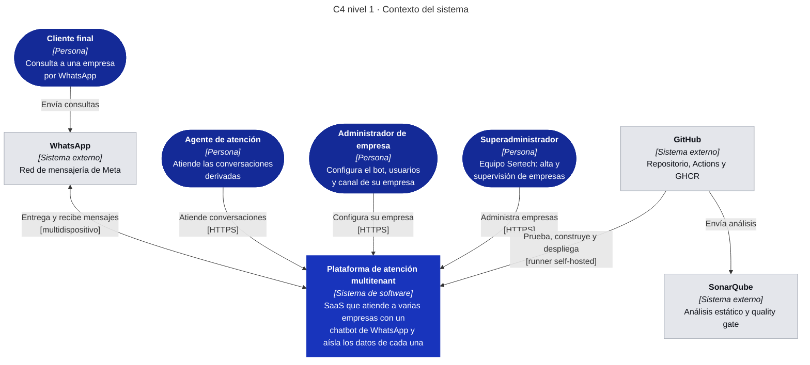

# C4 · Nivel 1 — Diagrama de contexto

Muestra la plataforma como una sola caja, las personas que la usan y los sistemas externos con los que se comunica.

**Leyenda:** azul oscuro = persona · azul = sistema que construimos · gris = sistema externo.
