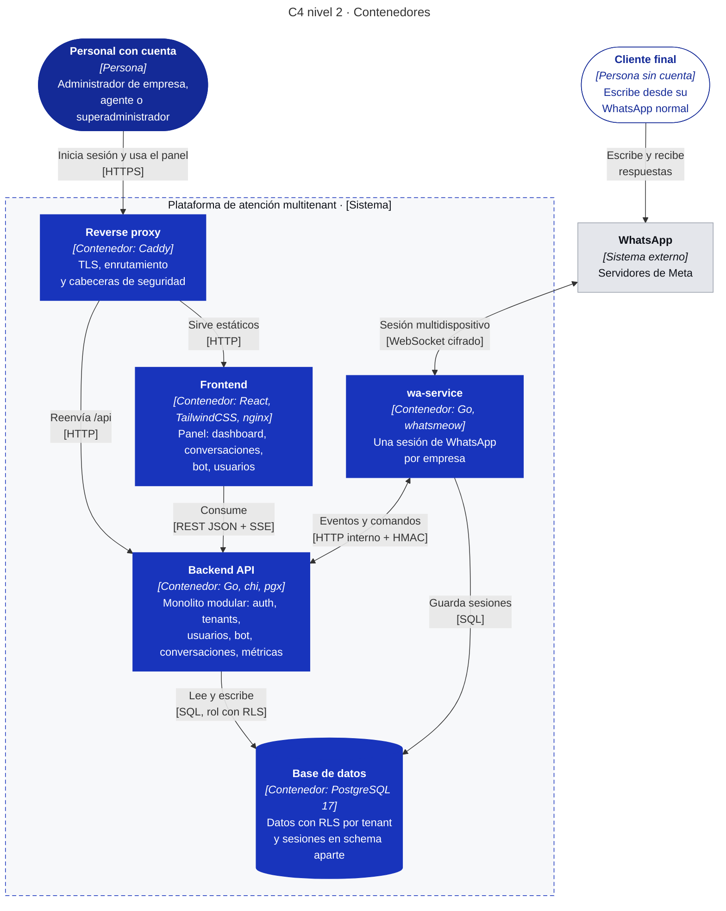

# C4 · Nivel 2 — Diagrama de contenedores

Cada caja es un contenedor Docker desplegado en el VPS. Solo Caddy se expone a internet; el resto vive en la red interna de Docker. Hay dos caminos de entrada: el personal con cuenta entra al panel por HTTPS, y los mensajes del cliente final llegan por la sesión de WhatsApp que mantiene wa-service.

## Decisiones clave

| Decisión | Motivo | ADR |
|---|---|---|
| Backend en Go como monolito modular | Una sola unidad de despliegue con módulos de bajo acoplamiento | [ADR-0001](../../adr/0001-backend-go-monolito-modular.md) |
| Aislamiento con RLS en PostgreSQL | El aislamiento no depende de que cada consulta lleve `WHERE tenant_id` | [ADR-0002](../../adr/0002-multitenancy-rls.md) |
| wa-service separado | Redesplegar el backend no corta las sesiones de WhatsApp | [ADR-0003](../../adr/0003-wa-service-separado.md) |
| El cliente final no tiene cuenta | Usa su WhatsApp de siempre; el panel es solo para el personal | [ADR-0004](../../adr/0004-cliente-final-solo-whatsapp.md) |
