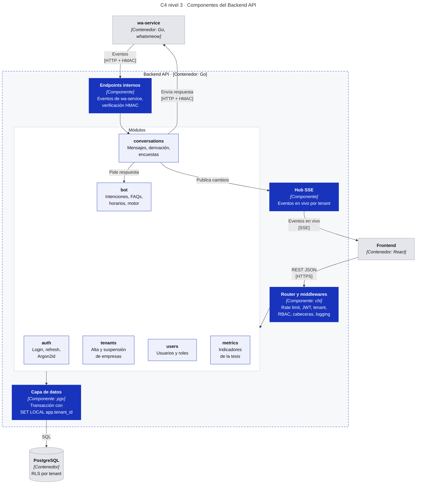

# C4 · Nivel 3 — Componentes del backend

El backend es un monolito modular. Cada módulo sigue las capas `handler → service → repository → domain` y solo se comunica con otros módulos a través de su `service`.



## Estructura de carpetas

```
backend/
├── cmd/api/main.go
├── internal/
│   ├── platform/              # transversal
│   │   ├── config/            # variables de entorno validadas
│   │   ├── database/          # pool pgx, helper WithTenantTx
│   │   ├── httpx/             # servidor, errores, respuestas JSON
│   │   ├── middleware/        # ratelimit, auth, tenant, rbac, secure headers
│   │   └── realtime/          # hub SSE
│   └── modules/
│       └── <modulo>/
│           ├── domain/        # entidades y reglas, sin dependencias externas
│           ├── repository/    # SQL parametrizado con pgx
│           ├── service/       # casos de uso
│           └── handler/       # HTTP: decodifica, valida, llama al service
├── migrations/
└── api/openapi.yaml
```

Regla de dependencias: `handler → service → domain ← repository`. Un módulo no importa el `repository` de otro.
