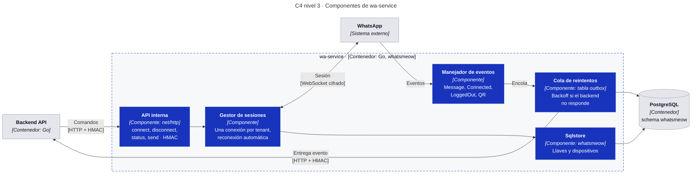

# C4 · Nivel 3 — Componentes de wa-service

wa-service es un gateway delgado: no contiene reglas de negocio del bot, solo mantiene las sesiones y traduce eventos de WhatsApp a llamadas HTTP internas. Es el único punto por el que llegan los mensajes del cliente final.

