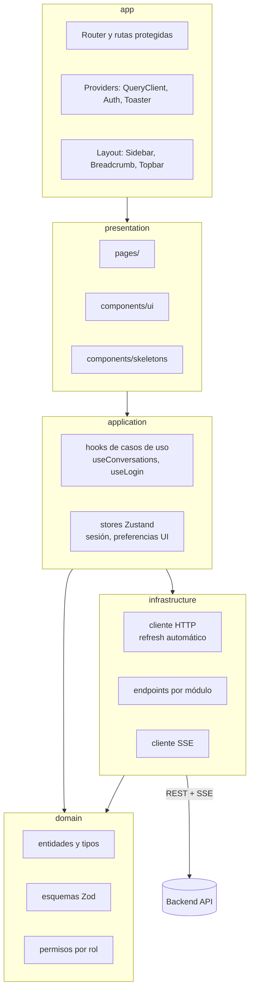

# C4 · Nivel 3 — Capas del frontend

El frontend es el panel del personal con cuenta; el cliente final no lo usa. Sigue una arquitectura en capas. Cada capa solo depende de las que están debajo de ella.



## Estructura de carpetas

```
frontend/src/
├── app/
│   ├── router.tsx
│   ├── guards.tsx           # RequireSession, RequirePermission
│   ├── layout/              # AppShell, Sidebar, Breadcrumb, Topbar
│   └── providers.tsx
├── presentation/
│   ├── pages/               # Dashboard, Conversaciones, Bot, Canal, Usuarios, Empresas, Login
│   └── components/
│       ├── ui/              # Button, Input, Table, Dialog, Badge, Tabs
│       └── skeletons/       # TableSkeleton, KpiSkeleton, ChatSkeleton
├── application/
│   ├── hooks/
│   └── stores/
├── domain/
│   ├── entities/
│   ├── schemas/
│   └── permissions.ts
└── infrastructure/
    ├── http/
    ├── api/
    └── realtime/
```
