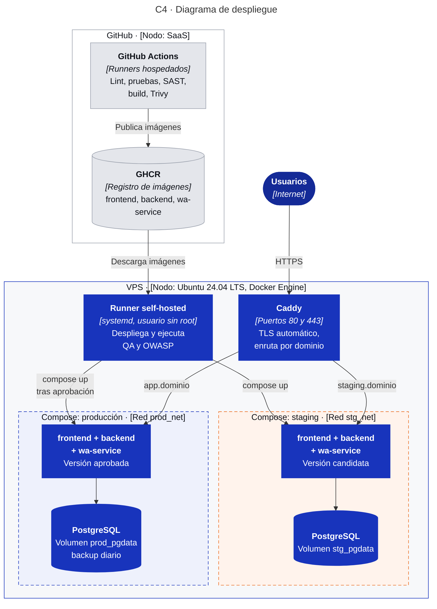

# Diagrama de despliegue — VPS Linux

Staging y producción corren en el mismo VPS como dos proyectos de Docker Compose separados, cada uno con su red y sus volúmenes. OWASP ZAP solo ataca staging.

## Endurecimiento del servidor

| Elemento | Configuración |
|---|---|
| Firewall | `ufw` con solo 22, 80 y 443 abiertos |
| SSH | Solo llave, sin login de root, fail2ban |
| Runner | Servicio systemd con usuario dedicado; acepta solo jobs de `main` |
| Puertos de contenedores | Ninguno publicado salvo Caddy |
| Secretos | GitHub Environments + archivo `.env` con permisos `600` |
| Backups | `pg_dump` diario por cron, rotación de 7 días |
