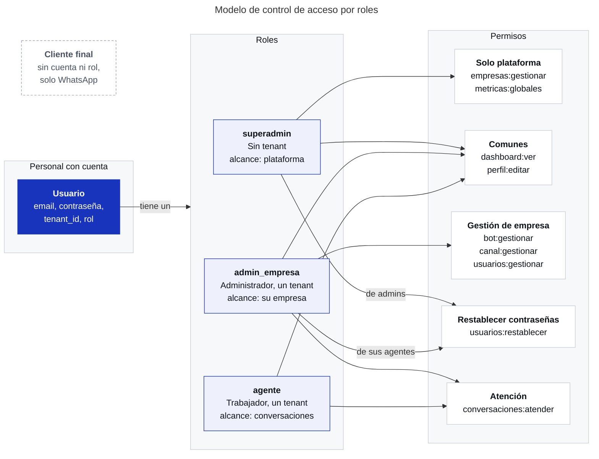
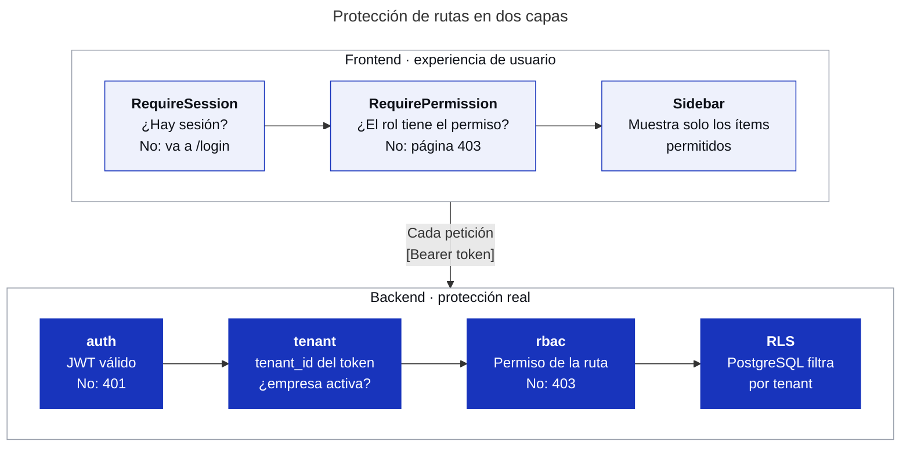

# Autenticación y roles

Todo acceso al panel exige iniciar sesión, y solo tiene cuenta el personal de las empresas y de Sertech.

## Quién ingresa a la plataforma

| Persona | ¿Tiene cuenta? | Cómo interactúa | Quién crea su cuenta |
|---|:---:|---|---|
| Cliente final | No | Desde su WhatsApp normal | No aplica |
| Agente (trabajador de la empresa) | Sí | Panel: conversaciones y dashboard | El administrador de su empresa |
| Administrador de empresa | Sí | Panel: bot, canal, usuarios, conversaciones y dashboard | El superadministrador o un administrador de su empresa |
| Superadministrador (Sertech) | Sí | Panel: empresas y métricas globales | Se crea al preparar la base de datos |

No existe registro público ni un rol para el cliente final. El sistema lo guarda como **contacto**, identificado por su teléfono y sin credenciales ([ADR-0004](../../adr/0004-cliente-final-solo-whatsapp.md)). En este documento, "usuario" siempre es una persona con cuenta.

Los permisos se asignan por **rol** y se verifican en dos lugares: en el backend, que es la protección real, y en el frontend, que solo oculta lo que el usuario no puede usar.

## Modelo de control de acceso (RBAC)

Cada usuario tiene un único rol. Los permisos de cada rol están definidos en el código, no en la base de datos, para que se puedan probar y versionar junto con el sistema.

## Matriz de permisos

| Permiso | Pantalla / endpoint | superadmin | admin_empresa | agente |
|---|---|:---:|:---:|:---:|
| `dashboard:ver` | Dashboard | Global | Su empresa | Su empresa |
| `conversaciones:atender` | Conversaciones | — | Sí | Sí |
| `bot:gestionar` | Bot (intenciones, FAQs, horarios) | — | Sí | — |
| `canal:gestionar` | Canal de WhatsApp (QR) | — | Sí | — |
| `usuarios:gestionar` | Usuarios de la empresa | — | Sí | — |
| `usuarios:restablecer` | Restablecer contraseña | Admins de empresa | Agentes de su empresa | — |
| `empresas:gestionar` | Empresas | Sí | — | — |
| `metricas:globales` | Métricas de todas las empresas | Sí | — | — |
| `perfil:editar` | Mi perfil y contraseña | Sí | Sí | Sí |

El superadmin **no** tiene `conversaciones:atender`: puede administrar empresas, pero no leer los mensajes de sus clientes.

## Pantalla inicial según el rol

| Rol | Redirección tras el login |
|---|---|
| superadmin | `/empresas` |
| admin_empresa | `/dashboard` |
| agente | `/conversaciones` |

## Protección de rutas en frontend y backend

Aunque alguien manipule el frontend para ver una pantalla que no le corresponde, el backend responde 403 y la base de datos no devuelve filas de otra empresa.

## Reglas de sesión y contraseñas

| Regla | Valor |
|---|---|
| Hash de contraseñas | Argon2id |
| Longitud mínima | 10 caracteres, se valida contra una lista de contraseñas comunes |
| Access token | JWT de 15 minutos, guardado solo en memoria |
| Refresh token | 7 días, cookie `httpOnly`, `Secure`, `SameSite=Strict`, con rotación |
| Reutilización de refresh token | Revoca toda la familia y cierra la sesión |
| Intentos fallidos | 5 seguidos bloquean la cuenta 15 minutos |
| Rate limit de login | 10 intentos por minuto por IP |
| Primer ingreso o contraseña restablecida | Cambio obligatorio antes de usar el panel |
| Cambio de contraseña, de rol o de estado, y restablecimiento | Revoca todas las sesiones del usuario |
| Mensajes de error | Siempre genéricos: no revelan si el email existe |
| Auditoría | Login, logout, fallos, bloqueos y restablecimientos |

## Documentos relacionados

- [Casos de uso de autenticación](../../02-uml/casos-de-uso/02-autenticacion.md)
- [Flujo de inicio de sesión](../../03-procesos/sistema/flujo-inicio-sesion.md)
- [Secuencia de login y renovación](../../02-uml/secuencias/01-login-refresh.md)
- [Secuencia de restablecimiento de contraseña](../../02-uml/secuencias/06-restablecer-contrasena.md)
