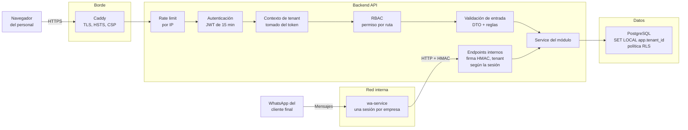

# Seguridad por capas

Recorrido hasta la base de datos de las dos entradas del sistema y los controles que atraviesa cada una: las peticiones del personal con cuenta, que pasan por el panel, y los mensajes del cliente final, que llegan por WhatsApp sin acceso al panel ni al API público. Cada control apunta a una categoría del OWASP Top 10.

| Control | OWASP Top 10 2021 |
|---|---|
| RBAC + RLS por tenant | A01 Broken Access Control |
| TLS, Argon2id, secretos fuera del código | A02 Cryptographic Failures |
| Consultas parametrizadas con pgx, validación de entradas | A03 Injection |
| Modelado de amenazas en ADRs | A04 Insecure Design |
| Cabeceras seguras, CORS restringido, errores sin detalles | A05 Security Misconfiguration |
| Trivy, `npm audit`, `govulncheck` en CI | A06 Vulnerable Components |
| Refresh con rotación, bloqueo por intentos fallidos | A07 Identification and Authentication Failures |
| Imágenes en GHCR etiquetadas por commit, gitleaks | A08 Software and Data Integrity Failures |
| Tabla de auditoría + logs estructurados | A09 Security Logging and Monitoring Failures |
| Sin peticiones a URLs que envíe el usuario | A10 SSRF |
