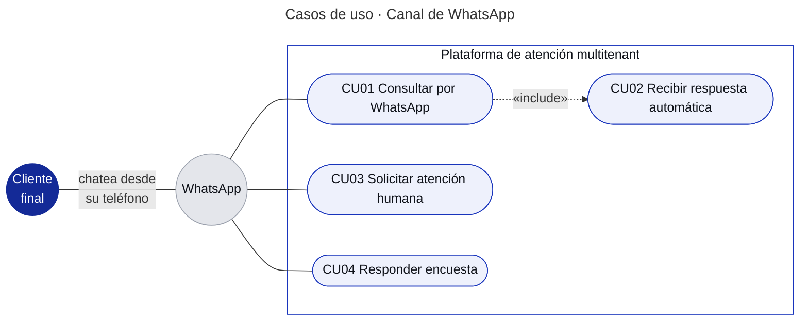

# Casos de uso · Canal de WhatsApp

El cliente final **no ingresa a la plataforma ni tiene cuenta**: chatea desde su WhatsApp normal con el número de la empresa. WhatsApp es el actor externo que conecta sus mensajes con el sistema.

