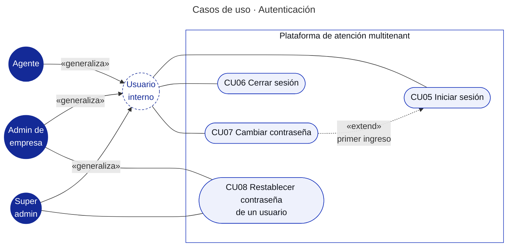

# Casos de uso · Autenticación

Todo usuario interno debe iniciar sesión para usar el panel. Agente, Admin de empresa y Superadmin son especializaciones de **Usuario interno** y heredan sus casos de uso.

## Especificación de CU05 · Iniciar sesión

| Campo | Detalle |
|---|---|
| Actor | Usuario interno (Agente, Admin de empresa, Superadmin) |
| Precondición | El usuario existe, está activo y su empresa no está suspendida |
| Flujo principal | 1. Ingresa email y contraseña. 2. El sistema valida las credenciales. 3. Emite la sesión. 4. Redirige a la pantalla inicial de su rol |
| Flujo alterno A | Credenciales inválidas: mensaje genérico, suma un intento fallido |
| Flujo alterno B | 5 intentos fallidos: cuenta bloqueada 15 minutos |
| Flujo alterno C | Usuario inactivo o empresa suspendida: mensaje genérico, sin revelar el motivo |
| Extensión | Primer ingreso o contraseña restablecida: se obliga a ejecutar CU07 antes de continuar |
| Postcondición | Sesión activa y registro en auditoría |
