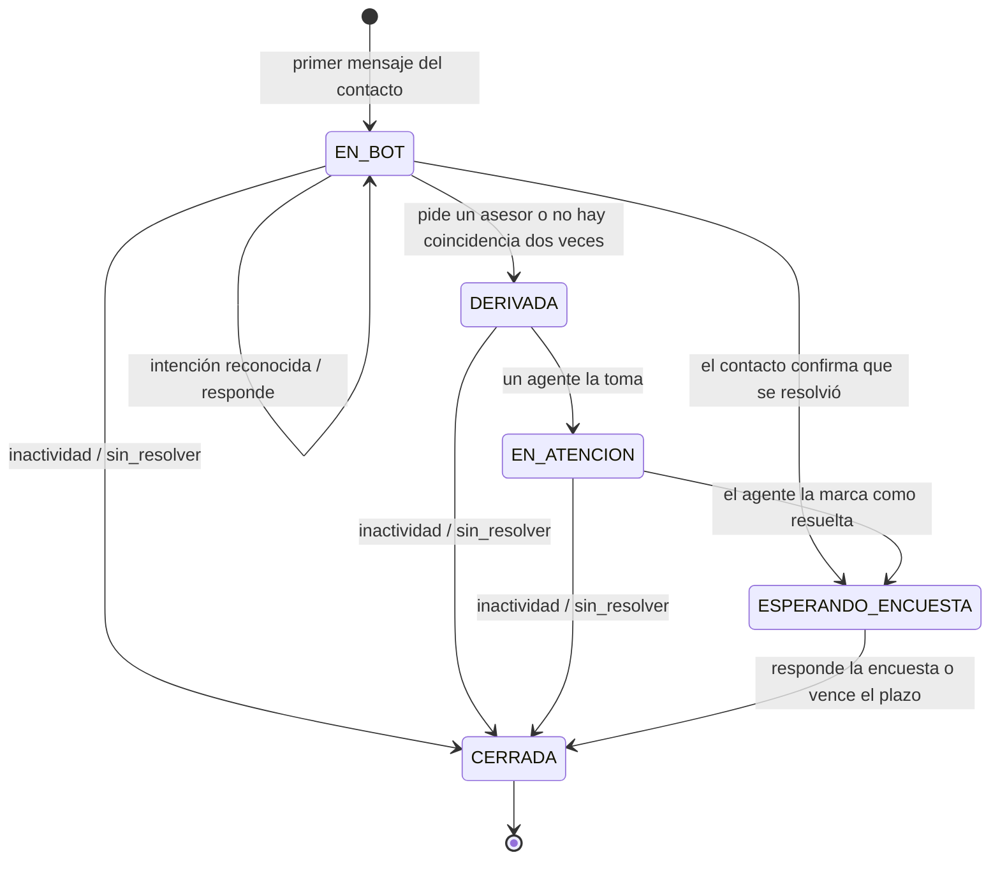

# Diagrama de estados — Conversación

Ciclo de vida de una conversación. El campo `resuelta_por` se fija al cerrar y alimenta el indicador de consultas atendidas automáticamente.

| Estado | Quién actúa | Se mide |
|---|---|---|
| EN_BOT | Motor del bot | Tiempo de respuesta del bot |
| DERIVADA | Cola de la empresa | Tiempo de espera hasta que un agente la toma |
| EN_ATENCION | Agente | Tiempo de respuesta humana |
| ESPERANDO_ENCUESTA | Contacto | Resolución y satisfacción |
| CERRADA | — | `resuelta_por`: bot, humano o sin_resolver |
