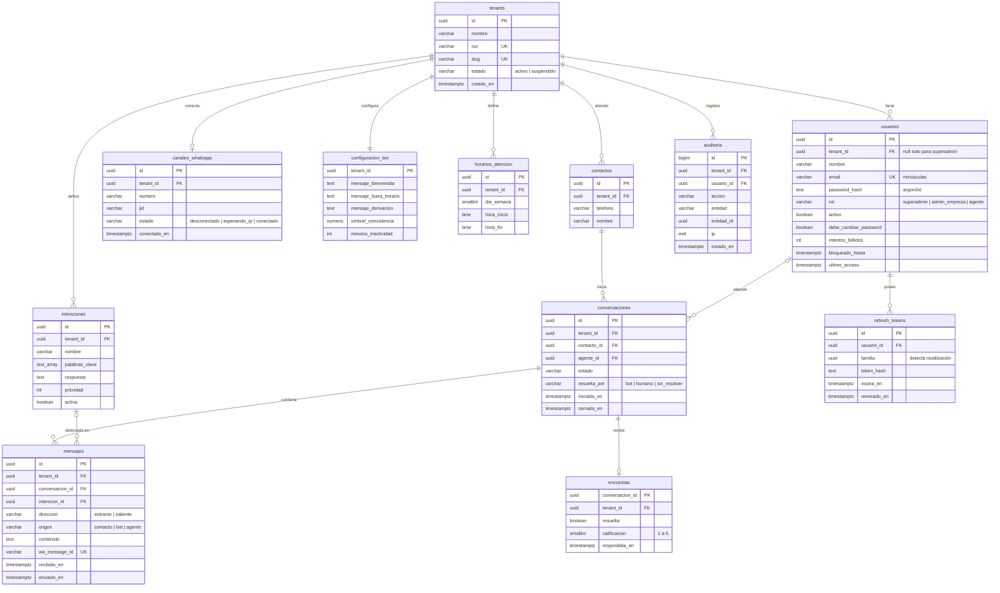

# Modelo entidad-relación

Modelo físico en PostgreSQL. Todas las tablas con `tenant_id` tienen Row-Level Security activada con la política `tenant_id = current_setting('app.tenant_id')::uuid`.

## Indicadores calculados desde el modelo

| Indicador | Consulta base |
|---|---|
| % atendidas automáticamente | `conversaciones` cerradas con `resuelta_por = 'bot'` / total cerradas |
| Tiempo promedio de respuesta | Promedio de `enviado_en` de la primera respuesta − `recibido_en` del mensaje entrante |
| % resueltas satisfactoriamente | `encuestas.resuelta = true` / encuestas respondidas |
| Satisfacción | Promedio de `encuestas.calificacion` expresado en % |
