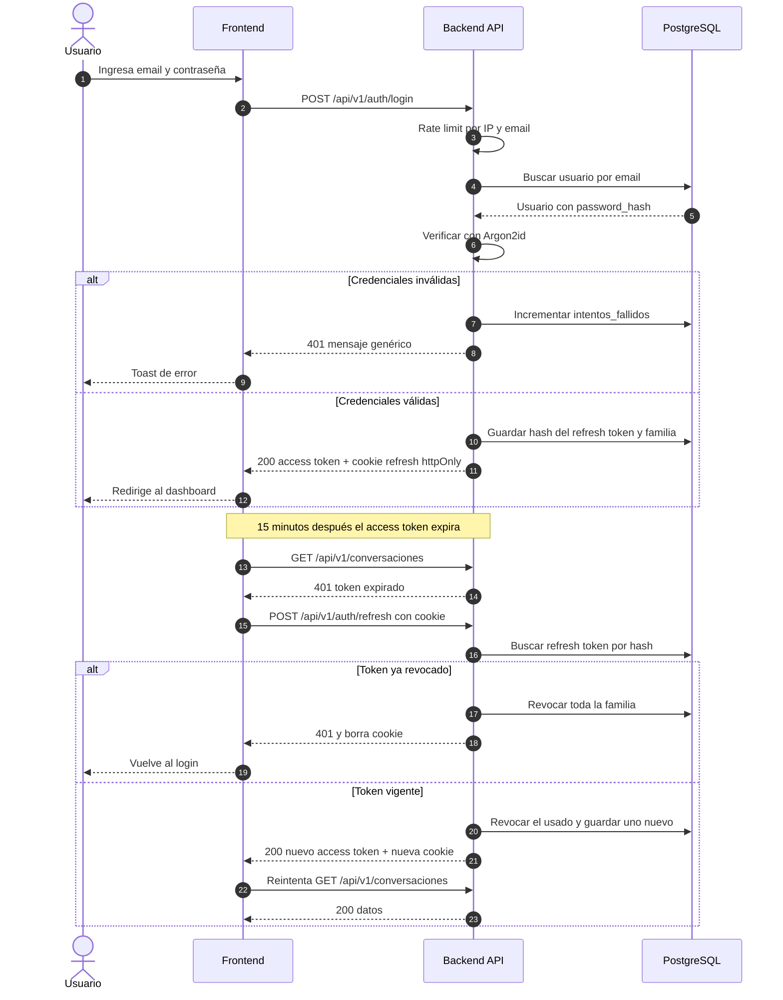

# Secuencia — Inicio de sesión y renovación de token

El access token vive en memoria del frontend; el refresh token solo viaja en una cookie `httpOnly`. Si un refresh token ya usado se presenta de nuevo, se revoca toda la familia.

