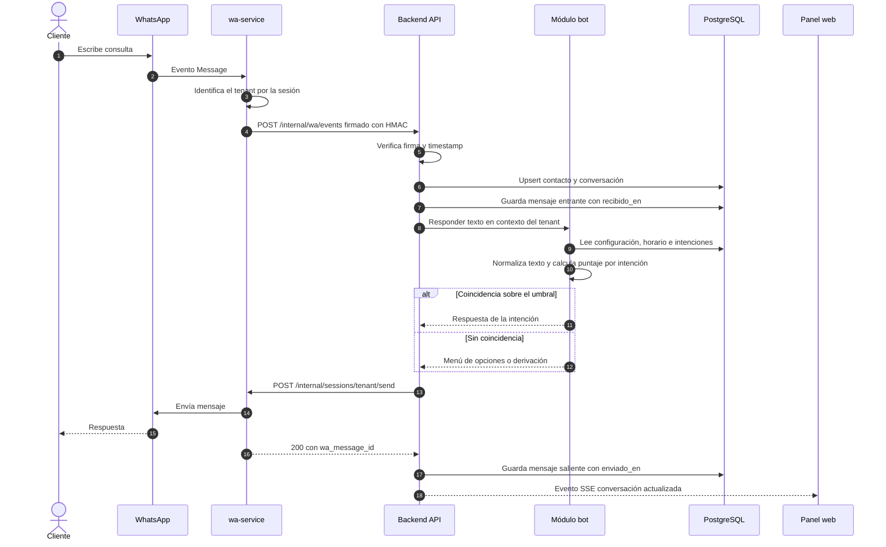

# Secuencia — Mensaje entrante respondido por el bot

Es el flujo principal del sistema. Los instantes `recibido_en` y `enviado_en` alimentan el indicador de tiempo promedio de respuesta (meta: 5 segundos o menos).

