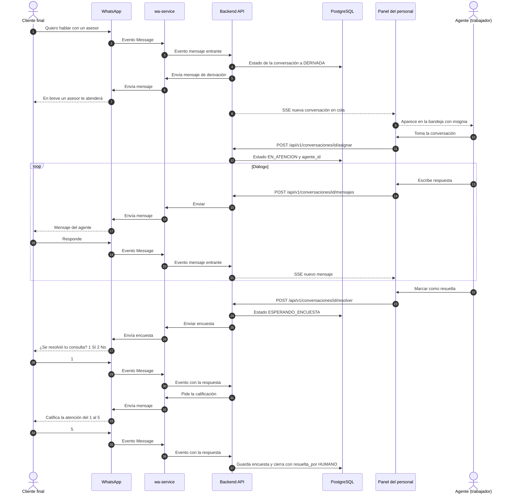

# Secuencia — Derivación a un agente y encuesta

El cliente final conversa todo el tiempo en su WhatsApp y no ingresa a la plataforma. El agente, que es un trabajador de la empresa, responde desde el panel.

