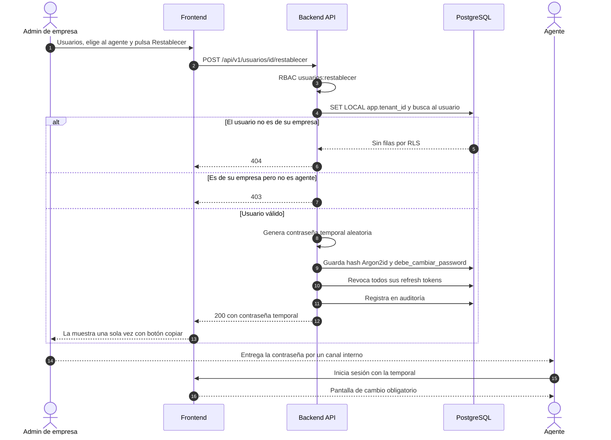

# Secuencia — Restablecer la contraseña de un usuario

Aplica solo al personal con cuenta. No hay recuperación por correo en esta versión: el administrador de la empresa restablece la contraseña de sus agentes, y el superadmin la de los administradores. La contraseña temporal se muestra una sola vez.

