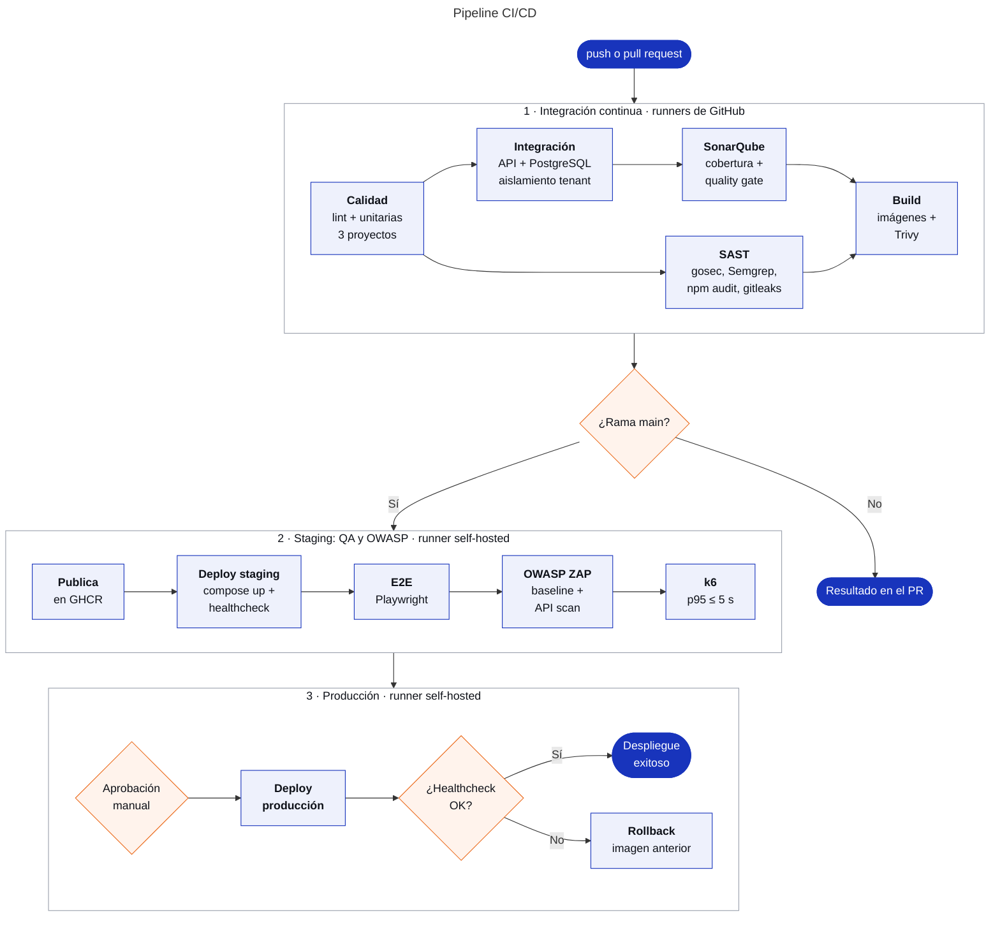

# Pipeline CI/CD

Cada flecha es una dependencia entre jobs de GitHub Actions. Si una etapa falla, las siguientes no se ejecutan y el cambio no llega a producción. Los resultados de cada ejecución alimentan el indicador de despliegues automatizados exitosos.

## Relación con ISO/IEC/IEEE 29119 y el enfoque Shift-Left

| Etapa del proceso de pruebas | Dónde ocurre |
|---|---|
| Estrategia y planificación | [estrategia-de-pruebas.md](../../04-calidad/estrategia-de-pruebas.md) |
| Diseño e implementación | Pruebas escritas junto con el código en cada historia |
| Preparación del entorno y datos | Postgres en contenedor + semillas de dos tenants |
| Ejecución | Jobs de calidad, integración, E2E, ZAP y k6 |
| Ejecución automática en el pipeline | Todo este diagrama |
| Registro de incidentes | Issues de GitHub creados desde los reportes |
| Monitoreo y control | Resumen de jobs + dashboard de SonarQube |
| Finalización y reporte | Artefactos del pipeline: cobertura, reporte ZAP, reporte k6 |
