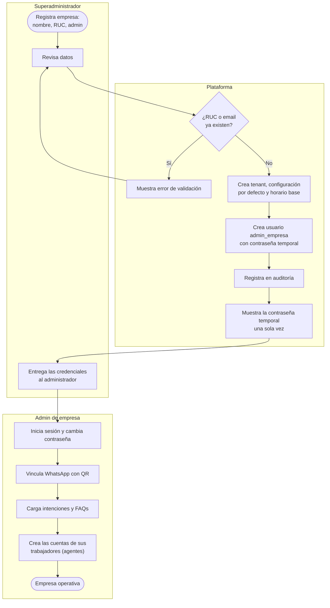

# Proceso de alta de una empresa (tenant)

Demuestra que una nueva empresa se incorpora sin crear una aplicación aparte: solo se crean filas nuevas en la misma base de datos. Las cuentas son para la empresa y sus trabajadores; sus clientes no se registran, escriben al número de WhatsApp vinculado.

