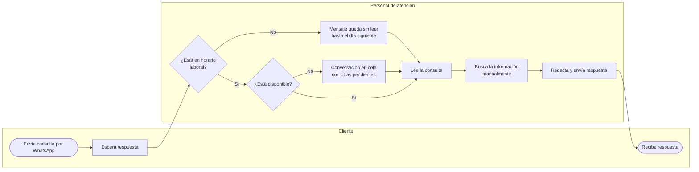

# Proceso de atención actual (AS-IS)

Situación antes de la implementación (pretest, O₁). Toda consulta depende de que una persona esté disponible.

**Problemas observados:** dependencia total del personal, demoras fuera de horario, respuestas repetitivas a las mismas preguntas y ningún registro medible del tiempo de atención.
