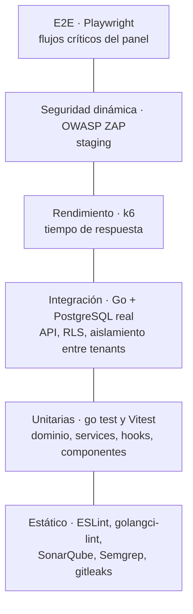

# Estrategia de pruebas

Basada en ISO/IEC/IEEE 29119-2 con enfoque Continuous Testing y Shift-Left: las pruebas se escriben junto con el código y se ejecutan en cada push.

## Pirámide de pruebas

## Tipos de prueba

| Tipo | Herramienta | Qué cubre | Cuándo |
|---|---|---|---|
| Análisis estático | ESLint + sonarjs, golangci-lint, SonarQube | Code smells, complejidad, duplicación | Cada push |
| Unitarias | `go test`, Vitest + Testing Library | Reglas de dominio, motor del bot, componentes | Cada push |
| Integración | `go test` con Postgres en contenedor | Repositorios, endpoints, middlewares | Cada push |
| Aislamiento multitenant | `go test` con dos tenants sembrados | Tenant A nunca lee ni escribe datos de B | Cada push |
| SAST y dependencias | gosec, Semgrep, `npm audit`, govulncheck, Trivy | Vulnerabilidades en código e imágenes | Cada push |
| E2E | Playwright | Login, bandeja, derivación, configuración del bot | Tras deploy a staging |
| DAST | OWASP ZAP baseline + API scan | OWASP Top 10 sobre el sistema desplegado | Tras deploy a staging |
| Rendimiento | k6 | p95 del endpoint de eventos ≤ 5 s | Tras deploy a staging |
| Aceptación | Manual con el Product Owner | Criterios de cada historia | Sprint Review |

## Casos de la suite de aislamiento (objetivo específico 1)

Cada caso se ejecuta con un token del tenant A contra recursos del tenant B. El indicador es `casos superados / casos totales`.

| ID | Caso | Resultado esperado |
|---|---|---|
| AIS-01 | Listar conversaciones | Solo devuelve las de A |
| AIS-02 | Leer conversación de B por ID | 404 |
| AIS-03 | Editar intención de B por ID | 404 y sin cambios en BD |
| AIS-04 | Eliminar usuario de B | 404 y sin cambios en BD |
| AIS-05 | Enviar `tenant_id` de B en el body | Se ignora; se usa el del token |
| AIS-06 | Consulta SQL directa sin `WHERE` con rol de la app | RLS devuelve solo filas de A |
| AIS-07 | Insert con `tenant_id` de B usando rol de la app | RLS rechaza la fila |
| AIS-08 | Métricas del dashboard | Solo agregan datos de A |
| AIS-09 | Evento SSE | A no recibe eventos de B |
| AIS-10 | Evento interno de wa-service con sesión de B | Se registra en B, no en A |

## Casos de la suite de autenticación y roles

| ID | Caso | Resultado esperado |
|---|---|---|
| AUT-01 | Login con credenciales válidas | 200, cookie `httpOnly` y redirección según el rol |
| AUT-02 | Login con contraseña incorrecta | 401 con mensaje genérico |
| AUT-03 | Login con email inexistente | 401 con el mismo mensaje y un tiempo de respuesta similar |
| AUT-04 | Cinco intentos fallidos | Cuenta bloqueada 15 minutos |
| AUT-05 | Usuario de empresa suspendida | 401 con mensaje genérico |
| AUT-06 | Petición sin token o con token expirado | 401 |
| AUT-07 | Token con firma alterada | 401 |
| AUT-08 | Reutilizar un refresh token ya rotado | 401 y se revoca toda la familia |
| AUT-09 | Agente llama a `/bot` o `/usuarios` | 403 |
| AUT-10 | Admin de empresa llama a `/empresas` | 403 |
| AUT-11 | Superadmin lee conversaciones de una empresa | 403 |
| AUT-12 | Primer ingreso | Solo permite cambiar la contraseña hasta hacerlo |
| AUT-13 | Cambio de contraseña | Revoca las demás sesiones |
| AUT-14 | El admin restablece la contraseña, desactiva o cambia el rol de un trabajador | Revoca las sesiones de ese usuario |
| AUT-15 | Crear una cuenta para un cliente final o registrarse por cuenta propia | 422 (no existe el rol) y 404 (no hay registro público) |

## Quality gate de SonarQube

| Métrica | Condición |
|---|---|
| Cobertura en código nuevo | ≥ 80 % |
| Líneas duplicadas en código nuevo | < 3 % |
| Bugs nuevos | 0 |
| Vulnerabilidades nuevas | 0 |
| Security hotspots revisados | 100 % |
| Calificación de mantenibilidad | A |

## Criterios de "terminado" (Definition of Done)

1. El código pasa lint y el quality gate de SonarQube.
2. Hay pruebas unitarias y, si toca BD, de integración.
3. Si la historia toca datos de negocio, hay un caso de aislamiento.
4. El pipeline está en verde hasta staging.
5. El Product Owner validó los criterios de aceptación.
