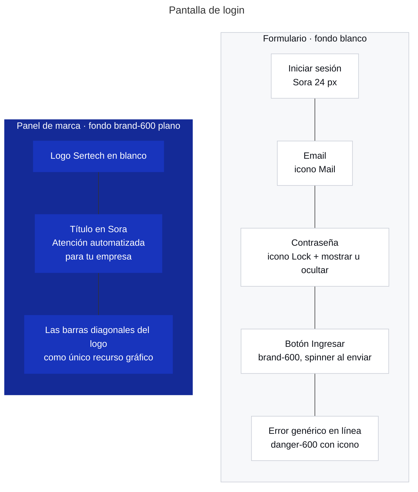
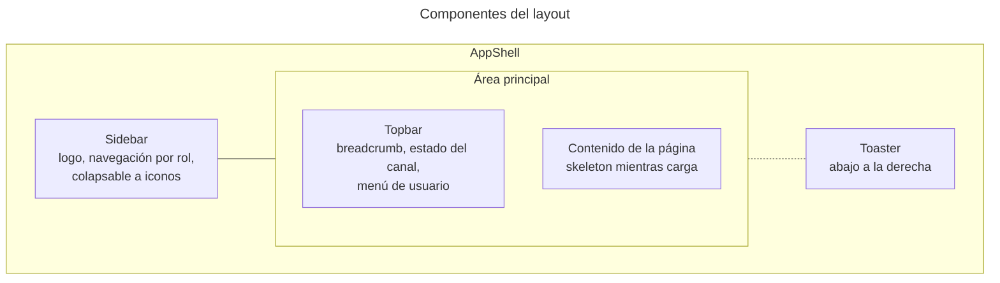

# Sistema de diseño

Reglas visuales del panel, que usa solo el personal con cuenta. El objetivo es un diseño sobrio y ordenado que se reconozca como de Sertech.

## Principios

- Sin sombras externas ni degradados. La jerarquía se marca con bordes de 1px, espacio y peso tipográfico.
- Sin emojis. Toda señal visual usa iconos de lucide-react con trazo de 1.75px.
- Poca carga por pantalla: una acción primaria por vista y la información secundaria en paneles o pestañas.
- El naranja se reserva para lo que exige atención; no se usa como decoración.

## Paleta (colores medidos sobre los archivos del logo)

| Token | Claro | Uso |
|---|---|---|
| `brand-600` | `#1834BC` | Botón primario, ítem activo del sidebar, enlaces |
| `brand-700` | `#142A97` | Hover del primario |
| `brand-50` | `#EEF1FC` | Fondo del ítem activo, selección |
| `accent-500` | `#EB6B1D` | Conversaciones derivadas, alertas, insignias de pendiente |
| `neutral-950` | `#0F1219` | Texto principal |
| `neutral-600` | `#4B5263` | Texto secundario |
| `neutral-200` | `#E4E6EB` | Bordes |
| `neutral-50` | `#F7F8FA` | Fondo de la aplicación |
| `white` | `#FFFFFF` | Superficies (tarjetas, tablas, sidebar) |
| `success-600` | `#16803C` | Conectado, resuelta |
| `danger-600` | `#C8312B` | Errores, acciones destructivas |

El modo oscuro reutiliza los mismos tokens con valores propios; los componentes nunca usan colores directos.

## Tipografía

| Rol | Fuente | Peso | Tamaño |
|---|---|---|---|
| Títulos de página | Sora | 600 | 24 px |
| Números de KPI | Sora | 600 | 30 px |
| Títulos de sección y tarjetas | Sora | 600 | 16 / 18 px |
| Cuerpo e interfaz | Poppins | 400 / 500 | 14 px |
| Etiquetas y ayudas | Poppins | 500 | 12 px |

Ambas fuentes se sirven desde el propio frontend (paquetes `@fontsource`), no desde Google Fonts, para no depender de terceros ni romper la CSP.

## Pantalla de login

Es la única pantalla sin sidebar. Se divide en dos columnas en escritorio y en una sola en móvil.

- Sin "Recordarme" ni "Olvidé mi contraseña": el restablecimiento lo hace un administrador (ver [Autenticación y roles](../01-arquitectura/seguridad/autenticacion-y-roles.md)).
- Errores siempre genéricos: "Email o contraseña incorrectos".
- El botón se desactiva mientras se envía, para evitar doble envío.

## Componentes del layout

## Navegación del sidebar por rol

| Ítem | Icono | Superadmin | Admin empresa | Agente |
|---|---|---|---|---|
| Dashboard | `LayoutDashboard` | Sí | Sí | Sí |
| Conversaciones | `MessagesSquare` | No | Sí | Sí |
| Bot | `Bot` | No | Sí | No |
| Canal de WhatsApp | `QrCode` | No | Sí | No |
| Usuarios | `Users` | No | Sí | No |
| Empresas | `Building2` | Sí | No | No |
| Configuración | `Settings` | Sí | Sí | No |
